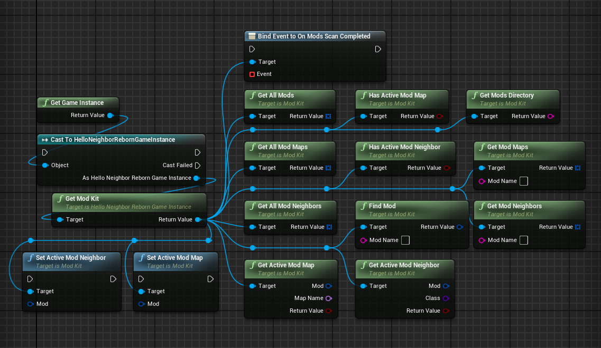
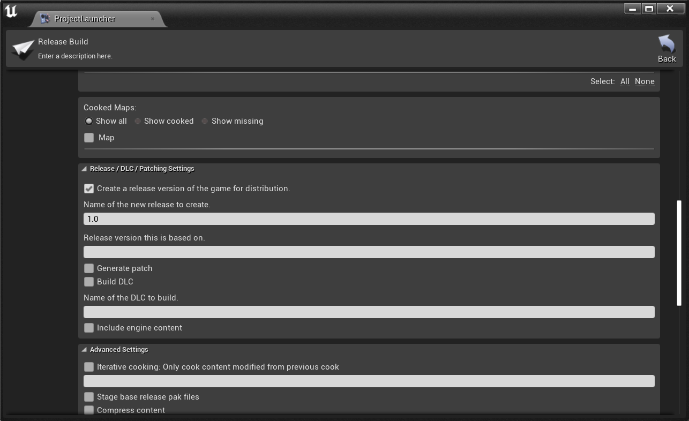
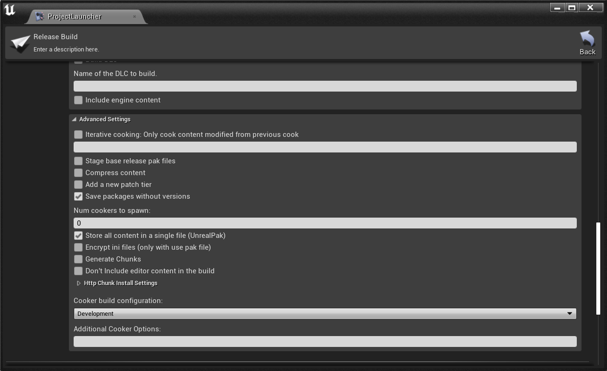
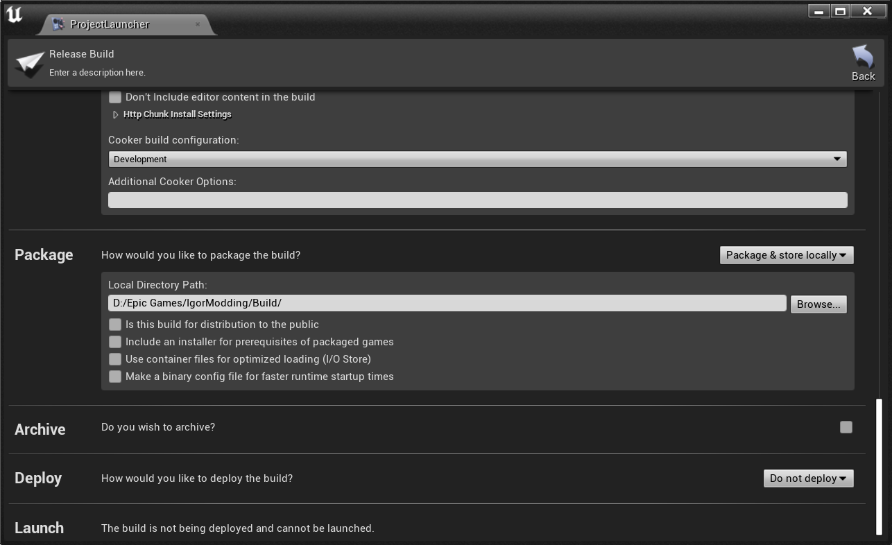
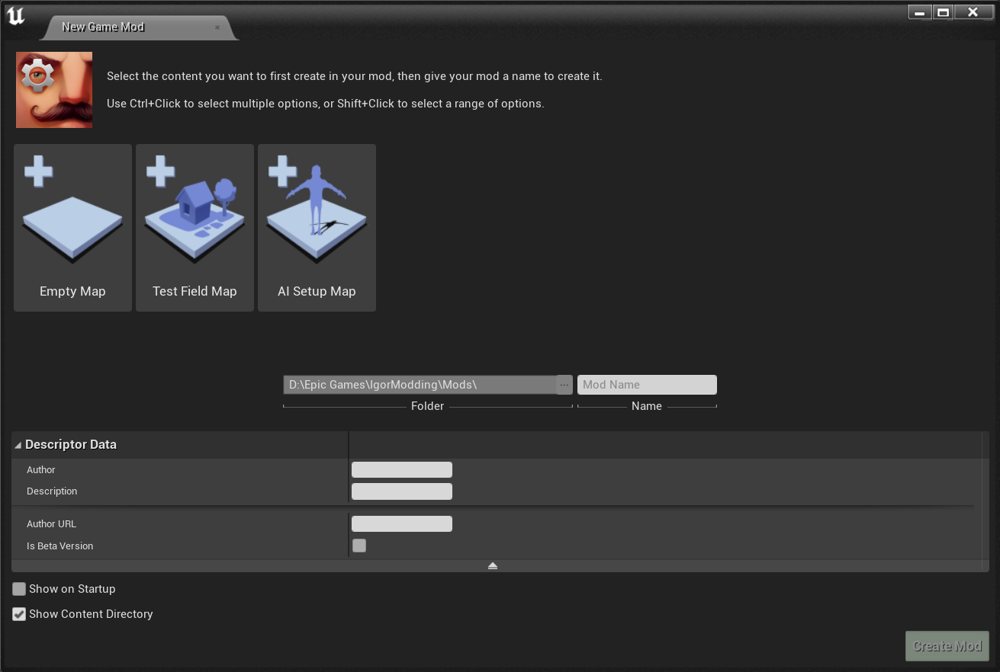
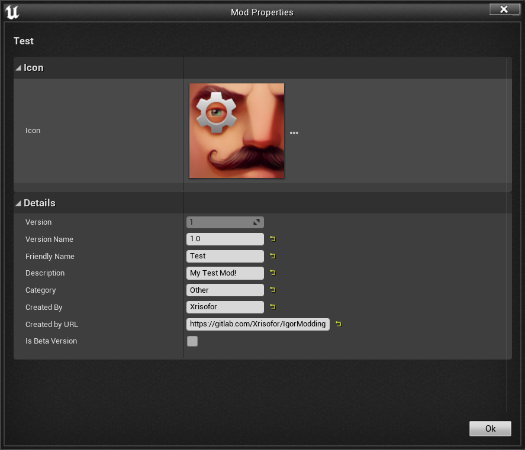

# IgorModding

> For Unreal Engine 4.27

A modding system for Unreal Engine that reproduces the core components and plugin workflow of the Hello Neighbor mod kit, so you can create, package and run mods the same way.

## Credits

The original system was created by **Igor Belov** during the development of Hello Neighbor. This version is based on it, extended and substantially reworked by **Xrisofor**.

## Features

- **GameInstance** - provides the `ModKit` singleton through `GetModKit()`.
- **UModKit** - the core mod manager: scans the `Mods` folder, reads plugin metadata and icons, and collects each mod's maps and neighbors.
- **Hello Neighbor Mod Plugin** - editor plugin for creating, packaging and publishing mods (see below).
- **ASosed** - base character class that mods build on.
- **ANeighborStart** - selects which Neighbor to spawn, letting mods control gameplay.

<div align="center">
    <br />
    GameInstance
</div>

## Building the Game

To build the game so that mods are detected correctly, use **Project Launcher**:

1. **Create a custom build profile** with any name.
2. **Build** - any build type works.
3. **Cook** - cook for `WindowsNoEditor` (recommended) and `Android (ASTC)`.
4. **Cook → Release / DLC / Patching Settings**:
    - Enable **Create a release version of the game for distribution**.
    - Set **Name of the new release to create** (recommended: `1.0`).
    - Use the same version in the `HelloNeighborMod` plugin settings (**Based On Release Version**).
5. **Cook → Advanced Settings** - enable only:
    - **Save packages without versions**
    - **Store all content in a single file (UnrealPak)**

   Leave every other option disabled, otherwise packaged mods will not appear in the game.
6. **Package** - configure as needed. Usually it is enough to set **Local Directory Path**, where the final build will be saved.
7. **Archive** - disabled.
8. **Deploy** - **Do not deploy**.

### Project Launcher Screenshots

|                Build & Cook                  |       Release / DLC / Patching Settings       |              Advanced Settings              |         Package, Archive & Deploy          |
|:--------------------------------------------:|:---------------------------------------------:|:-------------------------------------------:|:------------------------------------------:|
|  |  |  |  |

## The Hello Neighbor Mod Plugin

The plugin adds mod management, automated packaging and Steam Workshop publishing to the Unreal Editor toolbar.

### Key Features

- **Create Mod** - opens a creation wizard.
    - Built on a custom `IPluginWizardDefinition` with mod templates (Empty Map, AI Setup, Test Field, etc.).
    - Cleans up project files so each mod stays isolated.
    - Lets you set an icon and metadata during creation.

- **Package Mod** - automated multi-platform packaging.
    - Supports **Windows (64-bit)**, **Linux** and **Android (ASTC)**.
    - Uses the Unreal Automation Tool (UAT) to produce unversioned cooked content (DLC/Pak) based on a chosen release version.
    - Moves the result to `Saved/ModPackage`, ready for distribution.

- **Upload Mod (Steam Workshop)** - built-in publishing.
    - **One click**: if the mod isn't packaged yet, the plugin builds and uploads it in one step.
    - **Metadata sync**: Friendly Name, Description and Icon are taken from the plugin descriptor.
    - **Persistent ID**: the Workshop `PublishedFileId` is stored in `steam_id.txt` inside the mod folder, so later uploads update the existing item.
    - Shows upload progress and status directly in the editor.

- **Edit Mod Properties** - a custom details view for `.uplugin` metadata.
    - Edit Friendly Name, Author, Version and Category.
    - Replace the 128x128 mod icon from the same window.
    - Checks the descriptor out of Source Control before saving.

- **Plugin Settings** - found in **Project Settings → Plugins → Hello Neighbor Mod**.
    - **Based On Release Version** - must match your game's release version.
    - **Mod Templates** - paths and icons of the available templates.
    - **Supported Platforms** - target platforms and build flavors (e.g. Android ASTC).

### Steam Workshop Setup

To enable publishing, add the following to `DefaultEngine.ini`:

```ini
[OnlineSubsystemSteam]
bEnabled=true
SteamDevAppId=480
```

How it works:

- **Initialization**: on editor startup the plugin reads `SteamDevAppId` and creates `steam_appid.txt` next to the editor executable (e.g. `Engine/Binaries/Win64/`), which initializes the Steam API.
- **Conditional UI**: if the `[OnlineSubsystemSteam]` section or `SteamDevAppId` is missing, the **Upload Mod** button and all publishing logic are disabled.
- **Clean shutdown**: when the editor closes, the plugin shuts the Steam API down and leaves your environment as it was.

|           Create Mod Window            |         Edit Mod Properties Window          |
|:--------------------------------------:|:-------------------------------------------:|
|  |  |